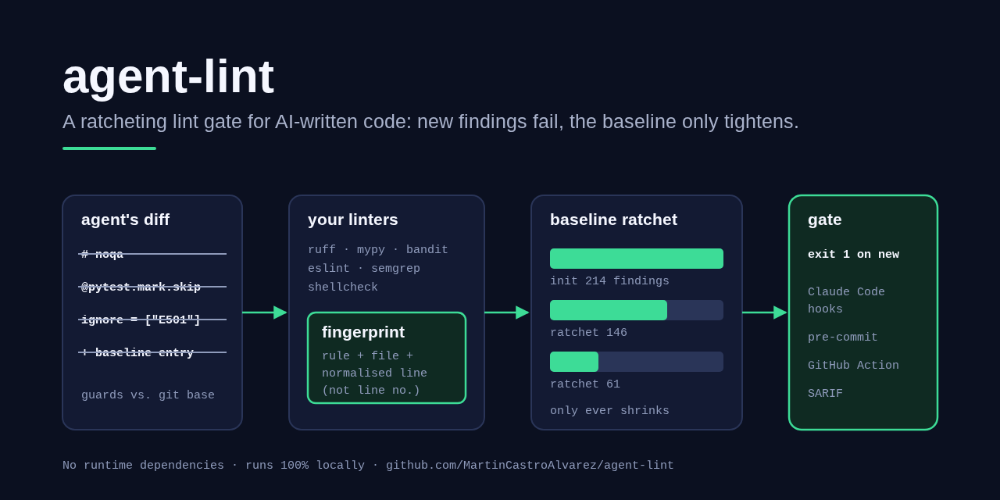
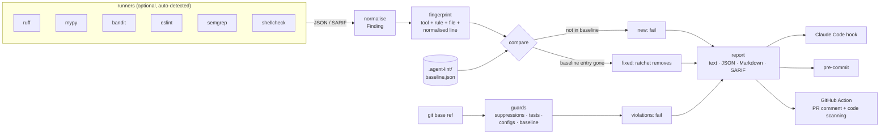

# agent-lint

> A ratcheting lint gate for code written by AI coding agents: new findings fail, the baseline only tightens, and the shortcuts agents take to get a green check (a `# noqa`, a skipped test, a loosened config) are caught.

[](https://github.com/MartinCastroAlvarez/agent-lint/actions/workflows/ci.yml)
[](LICENSE)
[](pyproject.toml)
[](pyproject.toml)
[](https://docs.github.com/en/code-security/code-scanning/integrating-with-code-scanning/sarif-support-for-code-scanning)



`agent-lint` runs the linters your project already uses (ruff, mypy, bandit,
eslint, semgrep, shellcheck; each optional, detected if installed), compares
their findings with a committed baseline (`.agent-lint/baseline.json`), and
fails on anything new. Fixed findings come out of the baseline with
`agent-lint ratchet`; nothing can put them back. Against a git base ref it also
catches the edits an agent makes to pass a gate without fixing anything. It
plugs into Claude Code hooks, pre-commit and GitHub Actions (PR comment +
SARIF for code scanning). No runtime dependencies. Runs 100% locally, no paid
APIs required.

## Why

Coding agents are good at making a red check green. Some of the ways they do
it are not fixes:

| The shortcut | Caught as |
| --- | --- |
| `# noqa`, `# type: ignore`, `# nosec`, `eslint-disable`, `@ts-ignore`, `# pragma: no cover` added | **AL201** |
| `@pytest.mark.skip`, `pytest.skip()`, `it.skip`, `xit`, or a focused `.only` | **AL202** |
| a failing test file deleted, or a test function removed | **AL203** / **AL204** |
| a test kept but its assertions removed | **AL205** |
| a rule dropped from `select`, an `ignore`/`exclude` added, `line-length` or complexity raised, mypy `strict` off, `fail_under` lowered, `-k`/`--deselect` in pytest `addopts`, an eslint rule relaxed, a tsconfig strict flag off | **AL301** |
| agent-lint's own config loosened, or agent-lint removed from CI / pre-commit | **AL302** |
| entries added to the baseline (or the baseline deleted) | **AL401** |

A plain "zero findings" gate does not work on an existing codebase, and a plain
baseline lets the agent re-baseline. A ratchet does both: legacy findings are
tolerated, new ones are not, and the tolerated set only shrinks.

## Quickstart

```bash
pip install "agent-lint @ git+https://github.com/MartinCastroAlvarez/agent-lint"
agent-lint init                    # record today's findings in .agent-lint/baseline.json; commit it
agent-lint check --base origin/main  # exit 1 on new findings or guard violations
agent-lint ratchet                 # after fixing old findings: shrink the baseline
agent-lint hook --print-config     # Claude Code hooks for .claude/settings.json
```

It will be `pip install agent-lint` once the first release is on PyPI.
`agent-lint explain AL201` explains a code; `agent-lint explain <fingerprint>`
shows a baseline entry; `agent-lint tools` shows which linters were detected.

```text
$ agent-lint check
NEW    app.py:9  ruff F821  Undefined name `itmes`  [342aa4c41d90e81f1f5b]
GUARD  app.py:13  AL201 new `noqa` suppression; fix the finding instead of silencing it  (# noqa: F401)
GUARD  pyproject.toml  AL301 ruff ignore: `E501` added
GUARD  pyproject.toml  AL301 ruff select: `B` removed
GUARD  tests/test_app.py  AL204 test `test_add_negative` was removed
GUARD  tests/test_app.py:6  AL202 pytest.mark.skip added (skip decorator)  (test_add)
agent-lint FAILED: 1 new, 5 guard violation(s), 0 fixed (tools: ruff)
```

([`examples/demo.sh`](examples/demo.sh) produces exactly this in a temp repo.)

## How it works



1. **Run.** Each runner builds an argv list (never a shell), runs the tool in
   the project root and parses its machine-readable output: ruff `--output-format
   json`, mypy `--output json`, bandit `-f json`, eslint `--format json`,
   semgrep `--sarif` (local rules only, `--metrics=off`), shellcheck `-f json1`.
   A tool that crashes or prints garbage is a failure, not a pass.
2. **Fingerprint.** `sha256(tool, rule, path, normalised source line, n)` —
   the line *number* is not part of it, so inserting code above an old finding
   does not make it new; whitespace is collapsed, so reformatting does not either.
3. **Compare.** New = fingerprint not in the baseline. Fixed = baseline entry
   (of a tool that actually ran) that is no longer reported. A tool that is
   not installed never "fixes" its entries.
4. **Guard.** `git diff --name-status <base>` (plus untracked files), with
   every file read twice — at the base ref via `git cat-file` and in the
   working tree — and compared: comments are tokenised (Python) or scanned
   (JS/TS), test files are parsed with `ast`, config files are reduced to a
   "policy" (`{key: (direction, value)}`) whose weaker direction is known.
5. **Ratchet.** `agent-lint ratchet` rewrites the baseline without the fixed
   entries. There is no command that adds entries except `init --force`, and
   the baseline guard (AL401) flags any growth relative to the base ref.

## Integrations

| | |
| --- | --- |
| **Claude Code** | `PostToolUse` on `Edit\|Write\|MultiEdit\|NotebookEdit` checks the edited file (exit 2 feeds the problems back to Claude); `Stop` runs the full gate and blocks the turn from ending. See [`integrations/claude-code/`](integrations/claude-code/). |
| **pre-commit** | `.pre-commit-hooks.yaml` in this repo, or a `local` hook. See [`integrations/pre-commit/`](integrations/pre-commit/). |
| **GitHub Actions** | composite [`action.yml`](action.yml): base = PR base sha, job summary, one sticky PR comment, optional SARIF upload. See [`integrations/github-action/`](integrations/github-action/). |
| **Code scanning** | `agent-lint check --sarif out.sarif` (SARIF 2.1.0 with `partialFingerprints`). |

## Configuration

`.agent-lint/config.toml`, or `[tool.agent-lint]` in `pyproject.toml`
(full commented example: [`examples/config.toml`](examples/config.toml)).
Unknown keys are errors, so a typo cannot silently disable a guard.

| Key | Default | Meaning |
| --- | --- | --- |
| `tools` | auto-detect | runners to use; listed ones are **required** (missing = failure) |
| `base` | `"HEAD"` | git ref the guards compare against (`--base`, `$AGENT_LINT_BASE` override it) |
| `exclude` | `[]` | gitignore-style globs whose findings and suppressions are ignored |
| `tests` | `[]` | extra test-file globs (on top of `test_*.py`, `*_test.py`, `tests/`, `*.test.*`, `*.spec.*` …) |
| `allow` | `[]` | substrings of suppression comments that are fine to add |
| `disable` | `[]` | guard codes to switch off (AL302 and AL401 cannot be) |
| `timeout` | `600` | seconds per linter invocation |
| `hook_tools` | ruff, eslint, shellcheck, bandit | runners used by the per-edit `PostToolUse` hook |
| `[<tool>] args` | `[]` | extra arguments for that linter (e.g. `[mypy] args = ["src"]`) |
| `[<tool>] executable` | `$PATH`, then `.venv/bin` / `node_modules/.bin` | binary to run |

Exit codes: `0` passed, `1` gate failed, `2` usage or configuration error.

## Testing

```bash
python -m venv .venv && . .venv/bin/activate && pip install poetry && poetry install
poetry run pytest                 # 145 tests, fixture repos built with `git init` in tmp dirs
poetry run ruff check agent_lint tests && poetry run mypy agent_lint
bash examples/demo.sh
```

The tests drive real ruff (a dev dependency) through real git repositories,
parse canned output for the other linters, run fake linters to prove argument
safety, and include a hostile `.git/config` (`diff.external`, `textconv`,
`core.fsmonitor`) that must never execute. Coverage is above 90%.

## Part of the series

| Series | Repositories |
| --- | --- |
| Agent tooling | **agent-lint** · [repo-graph-mcp](https://github.com/MartinCastroAlvarez/repo-graph-mcp) · [s3-agent-memory](https://github.com/MartinCastroAlvarez/s3-agent-memory) · [pytest-llm-evals](https://github.com/MartinCastroAlvarez/pytest-llm-evals) · [serverless-mcp-aws](https://github.com/MartinCastroAlvarez/serverless-mcp-aws) · [agent-model-router](https://github.com/MartinCastroAlvarez/agent-model-router) |
| Django admin family | [django-admin-react](https://github.com/MartinCastroAlvarez/django-admin-react) · [django-admin-rest-api](https://github.com/MartinCastroAlvarez/django-admin-rest-api) · [django-admin-mcp-api](https://github.com/MartinCastroAlvarez/django-admin-mcp-api) · [django-admin-graph](https://github.com/MartinCastroAlvarez/django-admin-graph) · [django-admin-skills](https://github.com/MartinCastroAlvarez/django-admin-skills) |
| Patterns catalog | [agentic-architectures](https://github.com/MartinCastroAlvarez/agentic-architectures) — every agent pattern, linking the LangGraph, ADK, CrewAI and LangChain repos |

## Contributing

See [`CONTRIBUTING.md`](CONTRIBUTING.md), [`ARCHITECTURE.md`](ARCHITECTURE.md),
[`SECURITY.md`](SECURITY.md) and the agent contract in [`CLAUDE.md`](CLAUDE.md).

## License

MIT © 2026 Martín Castro Álvarez. See [LICENSE](LICENSE).
